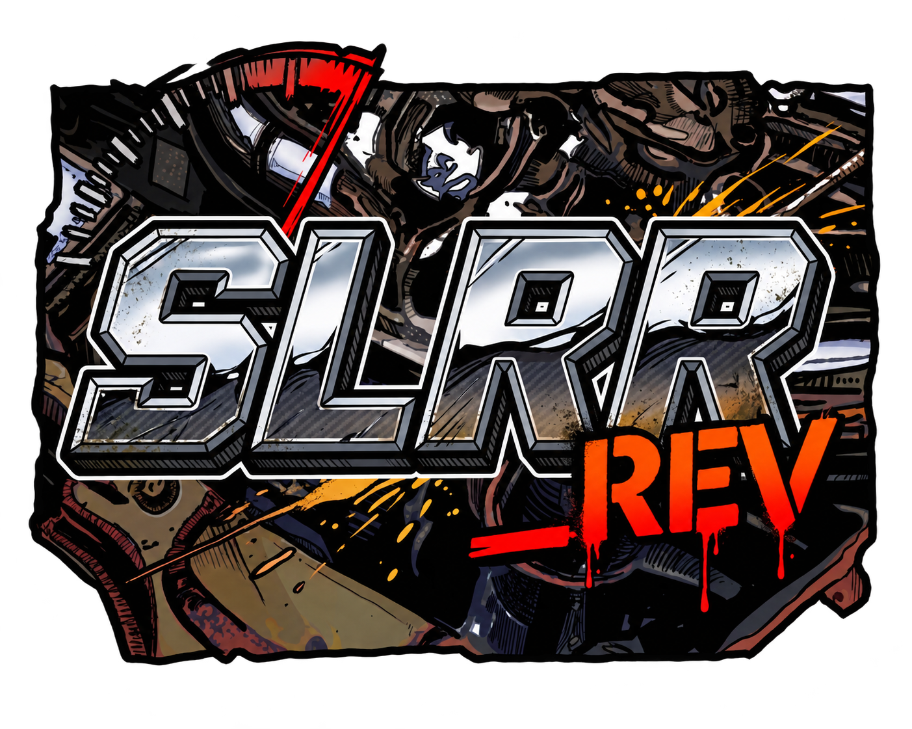
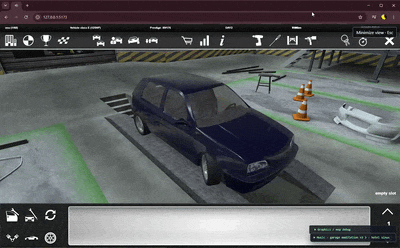

<p align="center">
  
</p>

<h1 align="center">SLRR REV</h1>

<p align="center">
  <strong>Street Legal Racing: Redline, rebuilt for the browser.</strong><br>
  A WebGL 2 engine remaster running the original game's assets and Java scripts.
</p>

<p align="center">
  
  
  
  
  <a href="docs/soft-body-wasm.md"></a>
  <a href="https://github.com/nedobylskiy/SLRR_rev/actions/workflows/ci.yml"></a>
</p>

<p align="center">
  <a href="#launch">Run</a> ·
  <a href="docs/README.md">Documentation</a> ·
  <a href="#verification">Build and tests</a> ·
  <a href="#projects-and-research-we-build-on">Sources and credits</a>
</p>



An open-source engine remaster of **Street Legal Racing: Redline**, rebuilt for the browser with WebGL 2. Written in TypeScript with an optional C++/WebAssembly physics backend, it brings the original game's assets and scripts to a modern web runtime.

The remaster is in active development.

Soft-body physics has an optional [C++ / WebAssembly backend](docs/soft-body-wasm.md) alongside the TypeScript implementation, with automatic fallback and a live debug selector. The bundled module runs without a native compiler.

The project reads original RPK and SCX v3/v4 assets and provides a resource inspector and WebGL scene. Its RPK/CFG factory assembles a Baiern from 33 base parts; mounts have also been checked on Einvagen, Duhen, Ninja, and Zed. The [driving prototype](docs/mounts-and-driving.md) and [Test Track loader](docs/maps.md) exercise the current physics and rendering systems. The separately published [SLRR-JVM package](https://github.com/nedobylskiy/SLRR-JVM) interprets original `.java` methods with host-provided imports and native functions; the engine can use [SLRR-JVM Decompiler](https://github.com/nedobylskiy/SLRR-JVM-decompiler) to recover missing system sources from TUFA `.class` files. Neither runtime executes `.class` bytecode. See [engine architecture](docs/engine-world.md) for the implemented boundaries; the full Java dialect, native game API, garage, and networked game loop remain open work.

## Projects and research we build on

This remaster builds on the work of the SLRR reverse-engineering and modding community:

- [OpenSLRR](https://github.com/EliasFD3S/openslrr) — a fellow open-source reconstruction of the SLRR engine. We actively exchange code, research findings, and implementation work with OpenSLRR, helping both projects move forward.
- [sl-remastered](https://github.com/nicolas-found42/sl-remastered) — recovered native engine calculations and research into vehicle physics, tyres, suspension, drivetrain, and combustion. Its scalar physics calculations underpin parts of our TypeScript implementation.
- [slrr-reverse](https://github.com/EliasFD3S/slrr-reverse) — research and reconstruction of resource formats, TUFA/TREE scripting structures, and native interfaces.
- [street-legal](https://github.com/nicolas-found42/street-legal) — research into native game behaviour, including chassis updates and the transfer of Java-script parameters into vehicle physics.
- [io_invo_scx](https://github.com/nonamesex/io_invo_scx) — SCX v3/v4 format references and tooling used to cross-check our independently implemented model parser.
- [slrr-javas](https://github.com/imagecode-git/slrr-javas) — published game Java sources and documentation of the original scripting environment.

See [sources and licensing notes](docs/sources.md), [third-party notices](THIRD_PARTY_NOTICES.md), and the [physics implementation notes](docs/physics-reverse-port.md) for detailed attribution and implementation scope.

## Launch

Node.js 22.12+ (tested on 24.13.1):

```powershell
npm ci
npm run dev
```

Open [http://127.0.0.1:5173](http://127.0.0.1:5173). The development server binds to `0.0.0.0`; another device on the same network can use the Network URL printed by Vite. Game assets, music and video are served by the host computer. By default, resources are read from the installed Steam game:

```text
C:\Program Files (x86)\Steam\steamapps\common\Street Legal Racing Redline
```

After connecting to an installation, the app first loads and executes that installation's original `sl/Scripts/game/src/Init.java` through SLRR-JVM. For system classes it prefers `system/scripts/<package>/src/<Class>.java`, then `system/scripts/<package>/decompiled/<Class>.java`; if neither exists, it decompiles the matching TUFA file in memory. The **Java Console** shows startup calls, the failing expression's source line, and the first missing method or native capability; **Restart Java** reruns the source after changes. Startup services are explicit temporary host adapters. `GameType.createNativeInstance()` creates a host-side game-tree node linked to its Java object. `GarbageCollector` construction, `push`, and `flush` are temporary no-op host adapters. Constructors of sibling classes declared in the same Java file, such as `CareerGoal` in `GameLogic.java`, also execute from source. `Controller.controlFile` receives the path passed to `Input.initControllers`. The [Math bridge](docs/java-math.md) covers all `Math` calls present in the installed game Java sources. `java.render.Text` native creation and updates target the HTML OSD layer while Java constructors and `changeText()` remain interpreted. OSD `PhysicsRef.createBox()` creates a transparent HTML hit target whose click calls the associated Java `Button.click()` method. The installed `LoadingScreen.java` runs `show()`, `hide()`, and `userWait()` through the shared JVM; the host supplies a render-frame signal and the original Java dialog and timer logic. `Sound.changeMusicSet(int)` now selects the music player's matching original playlist. In the tested build, execution starts the Java time-refresher thread, reaches `MainMenu.enter()`, and stops at `GfxEngine.openVideo(String,int,int,int)`. The separate menu and driving prototype buttons remain developer tools while the Java game loop is implemented.

To save decompiled system sources outside the original game's auto-compiled `src` folders, run `npm run decompile:system`. For example, `system/scripts/lang/Vector3.class` produces `system/scripts/lang/decompiled/Vector3.java`. Existing `.java` files are preserved by default; use `npm run decompile:system -- --overwrite` to regenerate them after updating the decompiler. Pass a game directory after `--` to use another installation. Generated game sources stay in that installation and are not committed to this repository.

Select the game installation with **Open game folder** if it is not at the default path. Use **Drive Test Track** to start a drive. The car starts in neutral: E selects first gear, Q reverse, and N neutral. W/S control throttle and reverse, A/D steer, Space brakes, Shift operates the clutch, I restarts a stalled engine, and R returns to the start. A manual transmission can stall when the clutch is released against a stationary driveline; restart it in neutral or with Shift held. The prototype currently has only automatic and manual transmission modes, without a separate automatic-clutch setting. Click the scene to give it keyboard focus; Esc minimizes the expanded driving view. Open **Tire model** for live Magic Formula B/C/D/E tuning of longitudinal and lateral grip, or switch to the previous tire response for comparison. Open **Engine tuning** to adjust idle and redline RPM using the original `Block.java` slider ranges. Both sets of tuning are saved in the browser; **Copy parameters** exports the current tire values as JSON.

The **Music** panel plays tracks from the selected game's `music/` folders. The interpreted original `MainMenu.java` selects its music set through `Sound.changeMusicSet`; the driving prototype currently selects the driving set itself. The panel shows the current track, file path, playback time, and volume, and can seek or skip tracks. Browsers can block automatic playback until you click **Play**. See [music integration](docs/music.md) for supported Java calls and the extended metadata API.

Vehicle drives also play spatial audio from the installed assets: the selected engine block's Java `SfxTable` chooses engine and exhaust samples, while tire contact and speed control surface and wind sounds. Click the driving view or use a vehicle key to enable audio if the browser has blocked it.

**Hood impact test** opens a [deformation prototype](docs/hood-prototype.md) using the original model. It demonstrates elastic response, permanent dents, mount failure, and a detached part falling to the ground. The solver's material and support constraints are generated by this project.

**Car and obstacle** places the [hood on the assembled car](docs/car-crash-demo.md). Contact with the crossbar deforms the panel; a broken mount releases the actual EngineWorld slot. The 10 and 50 km/h scenarios, slow motion, and manual controls help inspect the results.

A detached hood [collides with the body](docs/body-contacts.md), can bounce and rest on the roof or windows, and transfers contact impulse to the chassis. A separate roof-drop scenario and pause control make this easier to inspect.

The [3D car prototype](docs/vehicle-3d.md) has four CFG-derived suspension supports, jumps, body rotation, 13 deformable shells, and detachable rigid parts. Ramp and side-impact scenarios exercise the model. Its suspension and damage coefficients are new approximations, not recovered parameters of the original engine.

Another way:

```powershell
$env:SLRR_GAME_ROOT = 'D:\Games\SLRR'
npm run dev
```

You can also select the installation in the UI. Folder selection works in the static `dist/` build as well. Normal browsing reads game assets without changing them; `decompile:system` writes only the requested missing `.java` files. The original EXE and DLLs are not launched.

## Verification

```powershell
npm test
npm run build
npm run verify:game
npm run verify:java-boot
npm run verify:saves
npm run verify:vm
npm run verify:parts
npm run verify:world
npm run verify:gameplay
npm run verify:mounts
npm run verify:hood
npm run verify:crash
npm run verify:3d
npm run audit
```

`verify:game` checks the entire local corpus. The only expected exception in the tested installation is the empty `modding_tools/Map tools/maps/sample/meshes/sample.scx`: it is separately marked as expected-invalid, and is not accepted as a valid model. Any new exception fails the check with an error. Reports with full local results are in the ignored `local/`.

Results for the tested installation: **147/147 RPK**, **2921/2921 `.class` files** (2993 TUFA classes), and **6032 nonempty SCX** files; also **139 SDAT containers**, including **64 vehicle headers**. Structural validation alone does not establish correct script behavior or exact material rendering.

## Documentation

Start with the [documentation index](docs/README.md). Planned work includes [vehicle state in memory](docs/vehicle-serialization.md), broader TUFA semantics, and the native API. Vehicle state must be restorable from a network buffer without an intermediate disk save.

The repository does not contain game assets, saves, EXE/DLL files, the private `dllcall` source, or an engine received from the original developers. See [sources and licensing notes](docs/sources.md) for public references and their terms.
