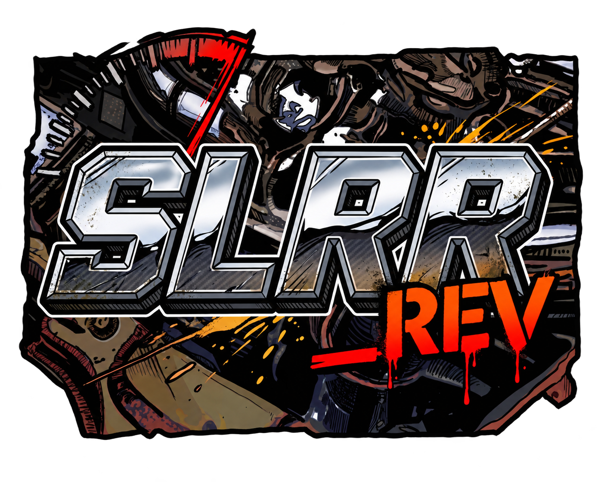
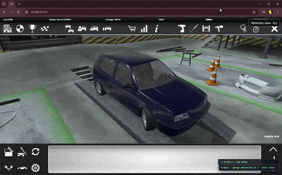

<p align="center">
  
</p>

<h1 align="center">SLRR REV</h1>

<p align="center">
  <strong>Street Legal Racing: Redline, rebuilt for the browser.</strong><br>
  A WebGL 2 engine remaster running the original game's assets and Java scripts.
</p>

<p align="center">
  
  
  
  
  <a href="docs/soft-body-wasm.md"></a>
  <a href="https://github.com/nedobylskiy/SLRR_rev/actions/workflows/ci.yml"></a>
  <a href="https://github.com/nedobylskiy/SLRR_rev/actions/workflows/standalone.yml"></a>
</p>

<p align="center">
  <a href="#download">Download</a> ·
  <a href="#ways-to-play">Ways to play</a> ·
  <a href="docs/README.md">Documentation</a> ·
  <a href="#development">Development</a> ·
  <a href="#projects-and-research-we-build-on">Credits</a>
</p>



## About

SLRR REV is an open-source engine remaster of **Street Legal Racing: Redline**.
The original game is a 2003 street-racing and car-building simulator: buy a
wreck, rebuild it part by part, tune it, and race it at night in the city.
Its engine was never published, so this project writes a new one in
TypeScript and WebGL 2. The new engine loads the files of an installed copy
of the game and runs the game's own logic.

The original game keeps most of its behaviour in Java scripts: menus, career,
garage, parts, races and AI. SLRR REV runs those scripts unchanged in
[SLRR-JVM](https://github.com/nedobylskiy/SLRR-JVM), its own interpreter for
the game's Java dialect. The native engine API those scripts call is
reimplemented on top of the new renderer, physics and audio.

What already works with an original installation:

- **The game itself.** The original `Init.java` boots into the main menu,
  career, garage, races and night races with AI rivals. Careers
  are saved in the browser.
- **Cars.** Cars are assembled from the original RPK/CFG parts with working
  slots and mounts. Garage tuning and painting work, including decals and
  spray strokes.
- **Physics.** Vehicle physics follows recovered formulas for tyres,
  suspension, drivetrain and engine. Soft-body deformation lets panels dent,
  mounts break and parts fall off. An optional
  [C++/WebAssembly backend](docs/soft-body-wasm.md) is available.
- **The city.** Traffic with lane changes and traffic signals, police
  pursuits, walking pedestrians with ragdolls, a minimap, knockable props,
  and night lighting.
- **Sound.** Spatial engine, exhaust, tyre and wind audio from the installed
  samples, and the original music playlists.

The remaster is in active development. Many native functions are still mocks;
the [native inventory](docs/native-status.md) lists what is implemented, what
is mocked and what is missing. The [verified status](docs/status.md) page says
what has been checked.

**You need your own copy of the game.** This repository contains no game
assets, saves, EXE/DLL files or engine code received from the original
developers. The original EXE and DLLs are never launched. Normal play only
reads the installation. Careers live in browser storage.

## Download

Every push to `main` builds the standalone clients. The newest builds are
always at the same links:

| Platform | File | Notes |
|---|---|---|
| Windows 10/11 x64 | [slrr-standalone-windows-x64.exe](https://github.com/nedobylskiy/SLRR_rev/releases/download/latest/slrr-standalone-windows-x64.exe) | Single executable, no installer |
| Android (arm64) | [slrr-standalone-android-arm64.apk](https://github.com/nedobylskiy/SLRR_rev/releases/download/latest/slrr-standalone-android-arm64.apk) | Touch controls, experimental |

The [latest release page](https://github.com/nedobylskiy/SLRR_rev/releases/tag/latest)
shows which commit the builds come from. Older runs are kept in the
[workflow's artifacts](https://github.com/nedobylskiy/SLRR_rev/actions/workflows/standalone.yml).

## Ways to play

All three ways run the same web build and need a Street Legal Racing Redline
installation: a folder that contains `system/` and `sl/`. Version 2.2.1 is
the main target; older frontends are supported as well.

### Browser (development server)

Requires Node.js 22.12+ (tested on 24). A Chromium-based browser is
recommended.

```powershell
npm ci
npm run dev
```

- **[127.0.0.1:5173/game.html](http://127.0.0.1:5173/game.html)** opens the
  player page: the game in a 16:9 frame.
- **[127.0.0.1:5173](http://127.0.0.1:5173)** opens the developer playground:
  the resource inspector, Java console, test tracks, physics stands and debug
  panels.

The server reads the game from the Steam default
`C:\Program Files (x86)\Steam\steamapps\common\Street Legal Racing Redline`.
To use another copy, set `SLRR_GAME_ROOT` before starting the server, or click
**Open game folder** on the page:

```powershell
$env:SLRR_GAME_ROOT = 'D:\Games\SLRR'
npm run dev
```

The server listens on `0.0.0.0`, so a phone or tablet on the same network can
open the Network URL that Vite prints; the host computer serves the game
files. Add `?touch=1` to turn on the on-screen wheel and pedal lever.
`npm run build:web` makes a static `dist/` build, which loads the game
through **Open game folder**.

### Windows client

Download [slrr-standalone-windows-x64.exe](https://github.com/nedobylskiy/SLRR_rev/releases/download/latest/slrr-standalone-windows-x64.exe)
and run it. It uses the system WebView2 (built into Windows 10/11) and
serves the page and the game files in-process, with no local server or open
port.

- On first start it looks for the Steam installation. If the game is not
  there, it asks for the game folder and remembers it. `--game <dir>` picks a
  folder for one run.
- The original videos (AVI) are converted on the fly when `ffmpeg.exe` is
  next to the executable or in `PATH`. Without ffmpeg, videos are skipped.

### Android

Install [slrr-standalone-android-arm64.apk](https://github.com/nedobylskiy/SLRR_rev/releases/download/latest/slrr-standalone-android-arm64.apk)
(allow installing apps from your browser or file manager).

- Copy the game folder to the phone first. On first start the app asks for
  that folder and copies it into app storage, so it needs as much free space
  as the installation takes.
- Touch controls: the on-screen steering wheel and pedal lever. Two fingers
  rotate the camera, and a pinch zooms. The toolbar opens the keyboard, the
  menu, the camera switch and the settings. The volume keys shift gears.
- Videos are skipped on Android.
- The APK is an experimental arm64 build. An update signed with another key
  cannot be installed over the previous one. In that case uninstall the old
  app, which also deletes the copied game files.

The [standalone client notes](docs/standalone-client.md) cover how the
clients work, local builds and signing.

## How it works

| Layer | What it does |
|---|---|
| Formats | Parsers for RPK resource packs, SCX v3/v4 models, TUFA classes, SDAT saves, CFG and textures ([formats](docs/formats/rpk.md), [installation map](docs/installation.md)) |
| Script runtime | [SLRR-JVM](packages/slrr-jvm/README.md) interprets the original `.java` sources. Missing system classes are decompiled from TUFA `.class` files with the [SLRR-JVM Decompiler](https://github.com/nedobylskiy/SLRR-JVM-decompiler) |
| Native API | Host implementations of the game's native classes: world objects, cameras, input, OSD, sound, files and threads ([native inventory](docs/native-status.md)) |
| World | RPK/CFG factory, car assembly and mounts, maps, traffic and pedestrians ([engine world](docs/engine-world.md)) |
| Physics | Vehicle dynamics and soft-body damage in TypeScript, with an optional WASM solver and a background worker ([physics notes](docs/physics-reverse-port.md)) |
| Rendering | three.js / WebGL 2 with original materials, lightmaps, LOD and Hi-Z occlusion culling |
| Clients | The Vite dev server, a static build, and a [Tauri 2](docs/standalone-client.md) shell for Windows and Android |

The [architecture overview](docs/architecture.md) and the
[documentation index](docs/README.md) go into detail.

## Development

### Tests and verification

```powershell
npm test          # unit tests (node:test via tsx)
npm run build     # strict TypeScript check and production build
```

These two run in CI on synthetic fixtures. The `verify:*` scripts check a local
installation, for example:

```powershell
npm run verify:game       # parse every RPK, class and SCX file
npm run verify:java-boot  # boot the original Init.java
npm run verify:saves      # SDAT decode/encode round trips
npm run audit             # file inventory of the installation
```

`package.json` lists the rest: parts, world, gameplay, mounts, physics stands
and traffic. With the tested installation, `verify:game` covers 147/147 RPK
files, 2921/2921 `.class` files (2993 TUFA classes) and 6032 non-empty SCX
files. Full reports go to the ignored `local/` folder.

### Useful tools

- `npm run decompile:system` writes decompiled system sources to
  `system/scripts/<package>/decompiled/` in the installation. Add
  `-- --overwrite` to regenerate them.
- `npm run report:natives` regenerates the native method inventory.
- `npm run standalone:debug` builds the Windows client locally.
  [Standalone client notes](docs/standalone-client.md) cover the Android
  build.
- The developer playground has research stands: the
  [hood deformation prototype](docs/hood-prototype.md), the
  [car and obstacle crash](docs/car-crash-demo.md),
  [body contacts](docs/body-contacts.md),
  [two-car collisions](docs/vehicle-pair-tests.md), the
  [3D car prototype](docs/vehicle-3d.md) and the
  [traffic test](docs/traffic-test.md).

## Projects and research we build on

This remaster builds on the work of the SLRR reverse-engineering and modding community:

- [OpenSLRR](https://github.com/EliasFD3S/openslrr) — a fellow open-source reconstruction of the SLRR engine. We actively exchange code, research findings, and implementation work with OpenSLRR, helping both projects move forward.
- [sl-remastered](https://github.com/nicolas-found42/sl-remastered) — recovered native engine calculations and research into vehicle physics, tyres, suspension, drivetrain, and combustion. Its scalar physics calculations underpin parts of our TypeScript implementation.
- [slrr-reverse](https://github.com/EliasFD3S/slrr-reverse) — research and reconstruction of resource formats, TUFA/TREE scripting structures, and native interfaces.
- [street-legal](https://github.com/nicolas-found42/street-legal) — research into native game behaviour, including chassis updates and the transfer of Java-script parameters into vehicle physics.
- [io_invo_scx](https://github.com/nonamesex/io_invo_scx) — SCX v3/v4 format references and tooling used to cross-check our independently implemented model parser.
- [slrr-javas](https://github.com/imagecode-git/slrr-javas) — published game Java sources and documentation of the original scripting environment.

See [sources and licensing notes](docs/sources.md), [third-party notices](THIRD_PARTY_NOTICES.md), and the [physics implementation notes](docs/physics-reverse-port.md) for detailed attribution and implementation scope.
